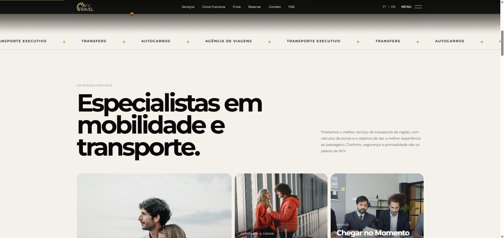
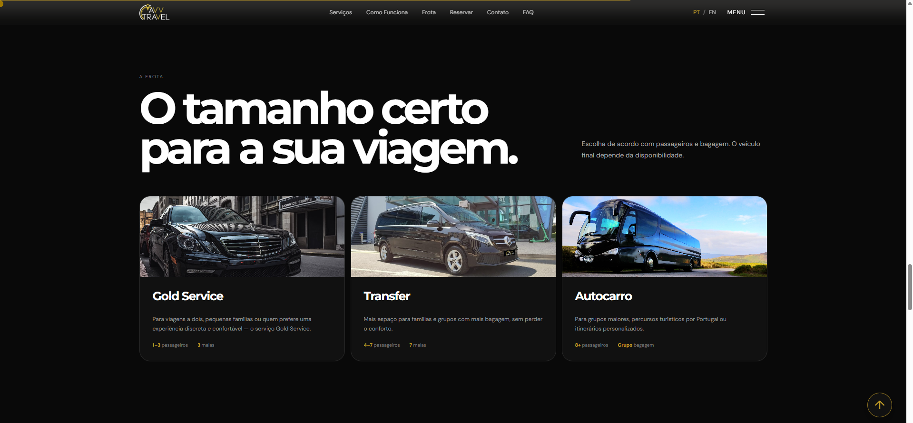
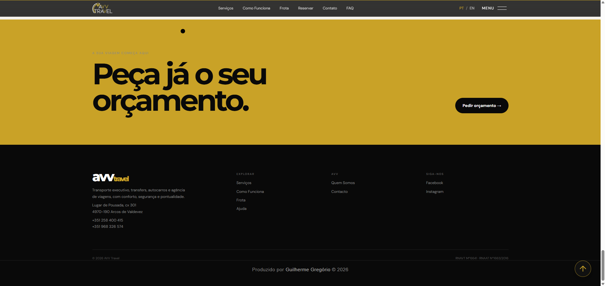
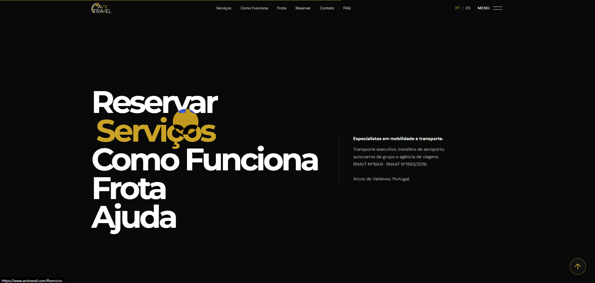

# AVV Travel — Site Institucional

Projeto de desenvolvimento web para a **AVV Travel**, empresa de transporte e viagens sediada em Arcos de Valdevez, Portugal.

O site apresenta a empresa e seus serviços, com foco na comunicação visual, na organização das informações e no acesso aos canais de contato para pedidos de orçamento.

🌐 **Site:** https://www.avvtravel.com/

📦 **Repositório:** https://github.com/djgregui/Avv-Site

## Objetivo do projeto

Transformar a apresentação comercial da empresa em uma experiência digital que permita conhecer os serviços, visualizar imagens e encontrar informações para planejar uma viagem ou solicitar transporte.

Os serviços apresentados incluem transporte executivo, transfers, autocarros e agência de viagens.

## Prévia do site

 

 

 

 

## Tecnologias utilizadas

| Tecnologia | Aplicação no projeto |
|---|---|
| **PHP** | Página principal e carregamento de configurações no servidor |
| **HTML** | Estrutura e organização do conteúdo |
| **CSS** | Estilização e apresentação visual |
| **JavaScript** | Comportamentos e interações da interface |
| **Git e GitHub** | Histórico de alterações e organização do código |

## Organização técnica

### Separação de responsabilidades

O projeto mantém a página principal, os estilos, os scripts e os recursos visuais em arquivos e diretórios separados.

Essa organização facilita localizar componentes, ajustar a apresentação e evoluir o site sem concentrar toda a implementação em um único arquivo.

### Configuração independente do código versionado

As configurações do ambiente ficam no arquivo `config.php`, excluído do repositório pelo `.gitignore`.

Essa separação permite manter parâmetros privados no servidor, sem incluí-los nos commits publicados.

### Organização dos recursos visuais

As imagens são agrupadas em diretórios específicos para identidade visual, galeria, ícones e detalhes dos serviços.

Essa estrutura facilita a manutenção do conteúdo visual e a substituição de imagens ao longo da evolução do projeto.

### Arquivos de idiomas

O projeto possui um diretório `lang/` dedicado à organização dos arquivos de idiomas.

### Controle de versões

O desenvolvimento utiliza Git para registrar alterações e GitHub para armazenar o histórico do projeto.

Os commits permitem acompanhar a evolução da implementação e consultar estados anteriores do código.

## Estrutura do projeto

| Caminho | Responsabilidade |
|---|---|
| `index.php` | Página principal do site |
| `assets/css/site.css` | Estilos da interface |
| `assets/js/site.js` | Scripts da interface |
| `img/logo/` | Identidade visual |
| `img/galeria/` | Imagens da galeria |
| `img/detalhes/` | Imagens relacionadas aos serviços |
| `img/icons/` | Recursos gráficos da interface |
| `lang/` | Arquivos de idiomas |
| `config.php` | Configuração privada, não incluída no repositório |
| `.gitignore` | Exclusão de configurações privadas e logs |
| `LEIA-ME.md` | Documentação complementar |

## Competências demonstradas

- Desenvolvimento web com PHP, HTML, CSS e JavaScript.
- Organização de arquivos por responsabilidade.
- Estruturação de conteúdo institucional e comercial.
- Gestão de recursos visuais.
- Separação de configurações privadas do código versionado.
- Controle de versões com Git e GitHub.

## Desenvolvimento

**Guilherme Gregório**

Projeto apresentado como parte do meu portfólio de desenvolvimento web.